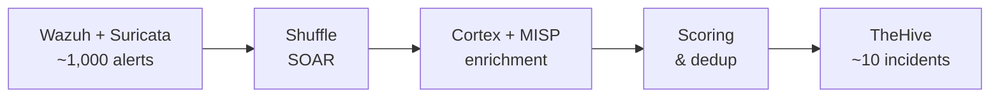

**Junior Cybersecurity Engineer** · 3rd-year Cybersecurity Engineering student

I'm after the whole field: how systems are built, how they get broken into and how all of that gets caught. Right now I'm deep in the defensive end, building a SOC lab from scratch. Breaking into it properly is next.

#### Currently building: SOC Automation Lab

A side project I'm building with friends, aimed at alert fatigue. The target is to take ~1,000 raw alerts, deduplicate, group and enrich them, and leave an analyst with ~10 incidents that actually need a human.

I built the lab and keep it running:

- **Network:** a Proxmox host behind OPNsense, with separate VLANs for victims, SOC tooling and the attacker box, and WireGuard access for the rest of the crew.
- **Telemetry:** Wazuh agents on an AD domain controller, Windows workstations, a Linux web server and the firewall itself. Sysmon on every Windows host, Suricata alerts going through the same pipeline.
- **Detection testing:** a deliberately vulnerable web app that we attack from Kali to see what gets caught.

→ [soc-automation-lab](https://github.com/ORG-OR-USER/soc-automation-lab)

#### Toolbox

| Area | Tools |
|---|---|
| Detection & logging |    |
| Response & threat intel |     |
| Infrastructure |       |
| Offense |  |

#### Off-screen
Urbex: abandoned factories and old hospitals, but also tunnels, rooftops and the kind of infrastructure most people only see from the outside.

Find me on [LinkedIn](https://www.linkedin.com/in/antonich2508/). Always happy to talk detection engineering, home labs or a good abandoned building.
